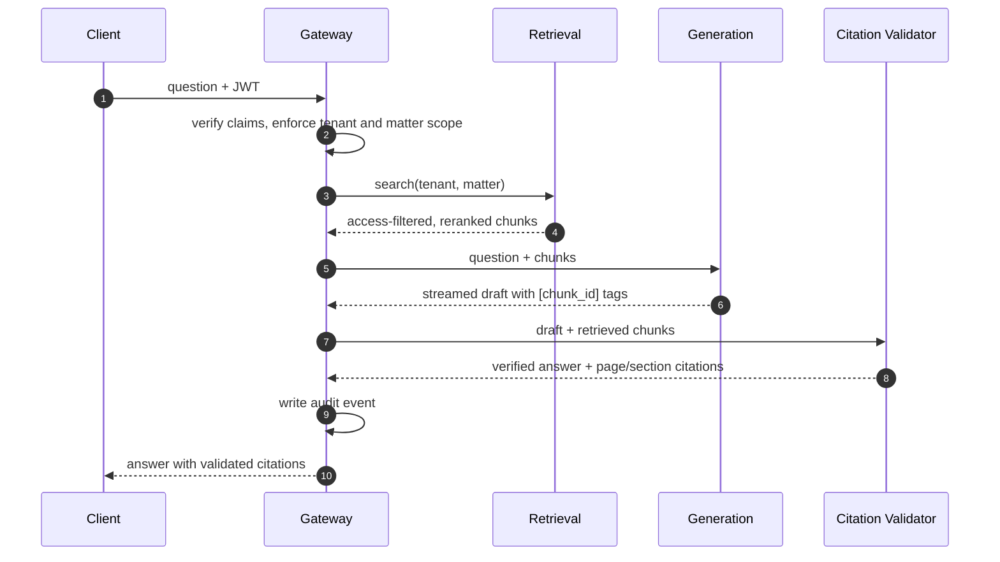
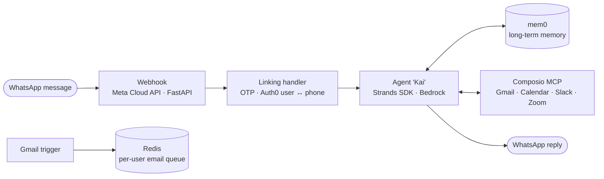

<h1 align="center">Ganpati Kumar Sah</h1>

  <b>AI/ML Engineer</b> &nbsp;·&nbsp; LLM Applications &nbsp;·&nbsp; RAG &nbsp;·&nbsp; Agent Systems

  <i>Building retrieval and agent systems that are grounded, access-controlled, and cost-aware.</i>

  
  
  <!-- Add LinkedIn here:
  
  -->

---

## About

I build LLM-powered systems end to end: ingestion, retrieval, generation, validation, and the service boundaries between them. I care most about the parts that decide whether an AI system can be trusted in practice: answers that can be verified against sources, tenant data that cannot leak, token spend that stays bounded, and agents that behave predictably.

- Building **MLQA-RAG**, a multi-service, citation-validated Q&A system for legal and medical documents
- Building **CPAA**, a WhatsApp-native personal agent that acts across Gmail, Calendar, Slack, and Zoom
- B.E. in Computer Science & Engineering (AI & ML), AMC Engineering College, Bengaluru
- Python & AI/ML technical training, TNS India Foundation (Aug – Oct 2026)

**Open to** AI/ML engineering roles focused on LLM applications, RAG, and agent systems.

---

## Featured Work

  <a href="https://github.com/Spark-of-Sun/MLQA-RAG">
    <picture>
      <source media="(prefers-color-scheme: dark)" srcset="https://github-readme-stats.vercel.app/api/pin/?username=Spark-of-Sun&repo=MLQA-RAG&theme=github_dark&hide_border=true">
      
    </picture>
  </a>
  <a href="https://github.com/Spark-of-Sun/CPAA">
    <picture>
      <source media="(prefers-color-scheme: dark)" srcset="https://github-readme-stats.vercel.app/api/pin/?username=Spark-of-Sun&repo=CPAA&theme=github_dark&hide_border=true">
      
    </picture>
  </a>

### [MLQA-RAG](https://github.com/Spark-of-Sun/MLQA-RAG): citation-validated Q&A over legal and medical documents

Answers natural-language questions over contracts, case files, clinical notes, and regulatory filings, and returns answers whose citations are **machine-checked against the retrieved sources** before they reach the user. Built as five independently deployable FastAPI services, with the full service topology running locally under `docker compose`.

**Design decisions**

| Decision | Why it matters |
|:--|:--|
| **Citations are verified by a gate, not trusted from the model** | Every `[chunk_id]` tag must resolve to a chunk that was actually retrieved *and* pass an NLI entailment check (DeBERTa cross-encoder) against the claim it supports. Failures are rewritten to `[unverified]`, or trigger regeneration, depending on tenant policy. |
| **Access filter runs before ranking, and is enforced twice** | Tenant, matter/patient, and confidentiality tier are filtered before scoring, so out-of-scope chunks can never influence results. The Gateway and Retrieval both enforce scope (defense in depth). |
| **Hybrid retrieval with reranking** | Dense vector search (Qdrant) plus BM25, because statute numbers, drug names, and dosages are exactly what pure semantic search misses. A cross-encoder reranker orders the final candidates. |
| **Domain-aware chunking** | Legal documents split by clause and section number; clinical notes split by SOAP fields. A citation resolves to a clause or note section, not an arbitrary token window. |
| **Token budget enforced before the LLM call** | Tokens are counted first, then chunks that do not fit are dropped whole in relevance order, never cut mid-chunk. Remaining context goes through LLMLingua compression, and responses are cached per tenant in Redis. |
| **Every heavy dependency sits behind a protocol** | Embeddings, OCR, reranker, compression, entailment, and the LLM provider (Anthropic or Gemini) each have a real and a fake backend, so CI runs the full test suite with no GPU and no API keys. |
| **Audit trail designed in from the start** | Each query emits a structured audit event with the question, retrieved and dropped chunk IDs, the validated answer, the validation outcome, and token usage. |

**Also in the repo:** async ingestion workers (Tesseract OCR, sentence-transformers embeddings, MinIO storage), shared libs for JWT and service-to-service auth, a field-level encryption helper, structured logging, and OpenTelemetry setup, plus a GitHub Actions pipeline with one test and lint job per service.

> **Status:** active development. Services, API contracts, and a 75-test unit suite are in place; Postgres-backed persistence, the evaluation harness, frontend, and production infrastructure are next.

`Python` `FastAPI` `Qdrant` `PostgreSQL` `Redis` `MinIO` `Docker Compose` `sentence-transformers` `LLMLingua` `OpenTelemetry` `GitHub Actions`

 

### [CPAA](https://github.com/Spark-of-Sun/CPAA): configurable personal AI agent on WhatsApp

A personal agent, "Kai", that takes natural-language requests over WhatsApp and carries them out across the tools a person already uses: Gmail, Google Calendar, Slack, Zoom, and other Composio toolkits.

- **Agent runtime:** Strands Agents SDK on AWS Bedrock. Each user's tools are loaded over MCP through Composio, with a sliding-window conversation and sessions that self-heal by clearing and retrying once on corruption.
- **Long-term memory:** mem0, scoped per user. The agent is instructed to search memory before answering anything personal and never to guess.
- **Identity and account linking:** Auth0 login on the dashboard; WhatsApp numbers are linked by a 6-digit OTP with a 10-minute expiry and a 3-attempt limit.
- **Performance:** per-user MCP session URLs cached in Redis for 7 days, tool lists cached for an hour, so each message skips tool discovery.
- **Event-driven:** Composio Gmail triggers feed a capped, TTL-bound per-user queue in Redis for email summaries.
- **Persistence and UI:** PostgreSQL through SQLAlchemy with Alembic migrations; a Next.js and TypeScript dashboard for integrations, WhatsApp linking, and memory.

`Python` `FastAPI` `Strands Agents` `AWS Bedrock` `MCP` `Composio` `mem0` `Redis` `PostgreSQL` `Next.js` `TypeScript`

 

### [noirchat](https://github.com/Spark-of-Sun/noirchat): privacy-first ephemeral messaging

A FastAPI messaging backend where the security properties are the product.

- Ephemeral **X25519** key exchange per sender session; private keys are **AES-256-GCM** encrypted before they ever touch Redis
- **Argon2id** hashing in the browser plus an HMAC challenge-response over a single-use nonce, so the server never sees the raw passphrase
- Randomized **response jitter** (50–200 ms) so timing cannot reveal whether a receiver exists
- Messages are **hard-deleted** once read or expired by a dedicated TTL cleanup worker

`Python` `FastAPI` `PostgreSQL` `Redis` `Argon2` `Vite`

---

## Tech Stack

<table>
  <tr>
    <td><b>Languages</b></td>
    <td>
      
      
      
      
    </td>
  </tr>
  <tr>
    <td><b>Backend & Web</b></td>
    <td>
      
      
      
    </td>
  </tr>
  <tr>
    <td><b>AI / ML</b></td>
    <td>
      
      
      
      
      
    </td>
  </tr>
  <tr>
    <td><b>Data & Infra</b></td>
    <td>
      
      
      
      
      
    </td>
  </tr>
  <tr>
    <td><b>Tooling</b></td>
    <td>
      
      
      
      
      
      
    </td>
  </tr>
</table>

**Focus areas:** NLP · LLMs · RAG · Embeddings · Prompt Engineering · Token Optimization · Model Evaluation · AI Agents

---

  <picture>
    <source media="(prefers-color-scheme: dark)" srcset="https://github-readme-stats.vercel.app/api/top-langs/?username=Spark-of-Sun&layout=compact&theme=github_dark&hide_border=true">
    
  </picture>

  English · Hindi · Nepali &nbsp;|&nbsp; Bengaluru, India

